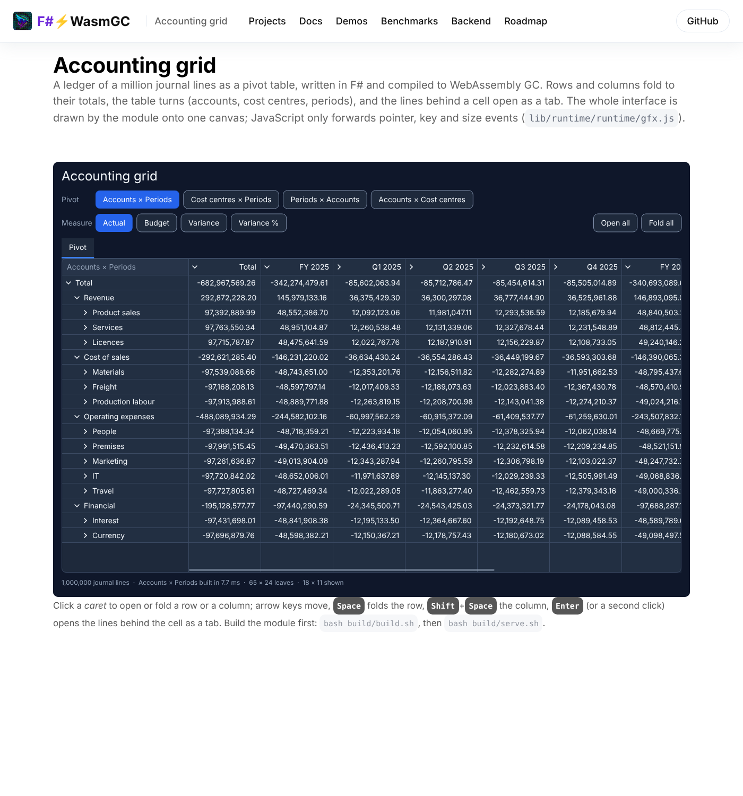
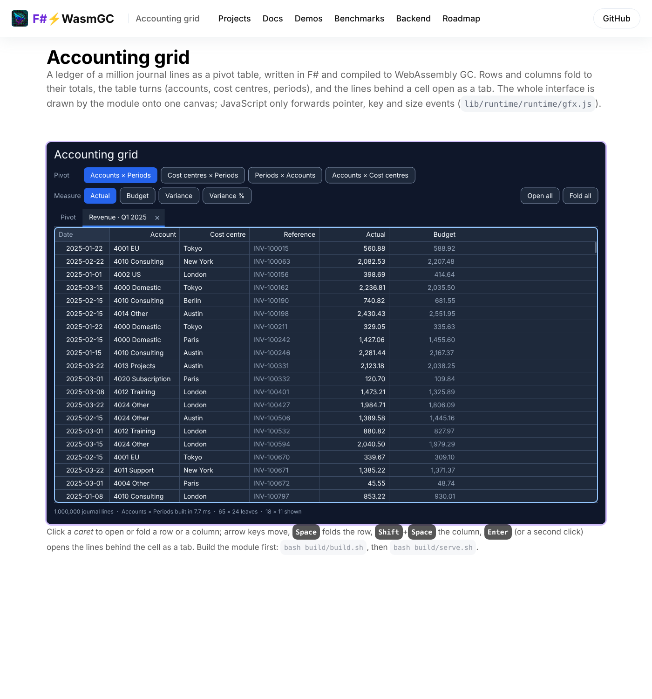

# fsharp-wasm-accounting

<!-- platform -->
> **Part of the [fsharp-wasm platform](https://fsharp-wasm.github.io/projects/)**: applications. Builds on [core](https://github.com/fsharp-wasm/fsharp-wasm-core), [graphics](https://github.com/fsharp-wasm/fsharp-wasm-graphics), [runtime](https://github.com/fsharp-wasm/fsharp-wasm-runtime).
> [All projects](https://fsharp-wasm.github.io/projects/) · [Roadmap](https://fsharp-wasm.github.io/docs/roadmap/) · [Tests](https://fsharp-wasm.github.io/tests/) · [Benchmarks](https://fsharp-wasm.github.io/benchmarks/) · [Live demos](https://fsharp-wasm.github.io/demos/)

An accounting grid: a ledger of **one million journal lines** as a pivot table that **folds its rows and columns to their totals**, turns (accounts, cost centres, periods), shows
Actual, Budget and the variance between them, and opens **the lines behind any cell as a tab** of its own. Written in F# and compiled to WebAssembly GC by
[fsharp-wasm](https://github.com/fsharp-wasm/fsharp-wasm); the whole interface is drawn by the module onto one `<canvas>`, and JavaScript only forwards pointer, wheel, key and size events.





## What it costs

Measured 2026-11-24 in a headless Chromium **without a GPU** (software rasterisation; `node tests/perf/grid.mjs`, three runs, the figures are medians of the best-agreeing run), on the
machine this was developed on. A GPU draws faster; compare before and after on one machine, not across machines.

| | |
|---|---|
| making the million lines (an account, a cost centre, a month, an amount, a budget) | 37 ms |
| turning the table: the cube built again from all million lines | 4 to 5 ms |
| the lines behind one cell | 4 ms |
| the lines behind the grand total, all million of them, found | 11 to 27 ms |
| a frame while scrolling the pivot table (83 rows × 35 columns open): the callback | 2.3 ms median, 3.3 ms at the 95th percentile; 0.6 ms of it is the module, the rest the browser's Canvas 2D |
| a frame while scrolling the million lines (a table of 1 000 000 rows) | 1.8 ms median, 3.1 ms at the 95th percentile; 0.5 ms the module's |
| the module | 213 KB, uncompressed |

Why it is fast: a hierarchy is a tree over ordered leaves, so every group is a **contiguous range**, and the cube keeps its matrix of leaves as **prefix sums**: the total of any group of rows over any
group of columns is four reads, however large the groups are. Turning the table is one pass over the lines. The grid draws only what is in its window, so a table of a million rows
costs a frame the same as one of eighty. See [`FSharp.Wasm.Frame`](https://github.com/fsharp-wasm/fsharp-wasm-core) and the `Grid` of [`FSharp.Graphics.Widgets`](https://github.com/fsharp-wasm/fsharp-wasm-graphics).

## Use it

- Click the **caret** of a row or a column that is a total to open or fold it; **Open all** and **Fold all** do the same to everything. The total at the top folds the whole table to one line.
- **Arrow keys**, Page Up/Down, Home and End move; **Space** folds the row of the cell, **Shift+Space** the column; **Enter** (or a second click) opens the lines behind the cell as a tab;
  the **wheel** scrolls, with **Shift** sideways.
- **Plan the budget**: on the **Budget** measure of accounts by periods (either way round), select a cell that is one account in one month and type (or **F2**): a number, or a formula that reads other cells (`=A1*2`,
  `=SUM(A1:C1)`) and the ledger by name (`=Actual*1.1`, `=Budget+100`). **Enter** and **Tab** keep it, **Escape** throws it away, **Delete** empties the cell, **Ctrl+Z** and **Ctrl+Y** take a step back and do it again.
  Every total above the cell moves by the difference and the variance follows; a formula marks its cell `ƒ`, a typed number `•`. The **History** tab lists the steps, newest first, with what the engine did for each:
  how many calcs it reached, how many ran, how many it left alone because they came out the same, and how many came out with another value.
- **Pivot** turns the table; **Measure** shows Actual, Budget, Variance (Actual − Budget of the totals) or Variance % (of the budget). A division by zero is a dash.

## Build and run

```bash
git submodule update --init lib/graphics lib/runtime lib/fsharp-wasm-core lib/wasmecto
source build/env.sh                      # FSHARP_WASM_CORE_DIR

bash build/test.sh                       # the tests, under .NET
bash build/build.sh                      # compile to WebAssembly GC: dist/AccountingGrid.wasm
bash build/serve.sh                      # http://127.0.0.1:8080/web/
node tests/e2e/grid.mjs                  # the module driven in Chromium (npm install first)
node tests/perf/grid.mjs                 # what it costs, as above
```

The compiler is not part of this repository: `build/build.sh` takes a release binary (`FSHARP_WASM_BIN`) or a checkout of [fsharp-wasm](https://github.com/fsharp-wasm/fsharp-wasm) (`FSHARP_WASM_DIR`, with `FSHARP_COMPILER` as the compiler's README says).

| path | what it is |
|---|---|
| `src/Accounting` | the application as a library: `Ledger` (a chart of accounts, cost centres, periods and the lines, made from a seed), `Planning` (the plan as a graph: a document, the cells as a sheet, the cube as a calc), `Model` (pivots, folding, tabs, keys, editing), `View`, `App` |
| `src/Accounting.Browser` | the module: the exports that `runtime/gfx.js` calls, and the counts the tests read |
| `tests/Accounting.Tests` | the ledger, the model and the scene, under .NET |
| `tests/e2e/grid.mjs`, `tests/perf/grid.mjs` | the compiled module in Chromium: what it does, what it costs |
| `lib/*` | submodules: graphics (the `Grid` and `Tabs` widgets, the canvas host), runtime (the glue), core (`FSharp.Wasm.Frame`, `Formula`, `Graph`, `Live`, the base library), wasmecto (the test framework) |

## Not yet

- The ledger is made up (a seed makes the same million lines every time); nothing is read from a file or a server yet.
- Only the Budget measure of accounts by periods is written; a plan by cost centre (the cells are per account and month) is not there. The plan is in the browser's memory: there is no file or server to keep it, though every step
  is a patch (`FSharp.Wasm.Graph`) that could be sent.
- The plan is one mutable graph that the models of a run share (an earlier model sees the later steps): the loop only moves forward, and the tape and the undo are what go back.
- The totals of a group can be a sum, an average, the first or the last of its leaves; a minimum and a maximum are not there.
- A screen reader is told the one cell that is selected (the grid's value), not the cells: a table of a million rows cannot be in the accessibility tree. The overlay for tables belongs to the accessibility layer of the platform, which is not finished.
- Sums are floating point (exact to the cent for totals up to about 10^11).

## Contributing

Welcome. [CONTRIBUTING](https://github.com/fsharp-wasm/.github/blob/develop/CONTRIBUTING.md) is the organisation's guide and [AGENTS.md](AGENTS.md) says how the platform is worked on (the compiler comes first: a fault found here
is fixed in the compiler, not worked around here).

- **Run the tests:** `bash build/test.sh` (under .NET); `node tests/e2e/grid.mjs` for the compiled module in Chromium.
- **A good first contribution:** A measure or a formula over the ledger, with a test against a hand-computed answer. Issues labelled [`good first issue`](https://github.com/fsharp-wasm/fsharp-wasm-accounting/labels/good%20first%20issue) are the places to start.
- **A change** goes to `develop` as a pull request, with a test that fails without it. Open an issue first for anything larger than a fix.

## License

[Apache-2.0](LICENSE).
